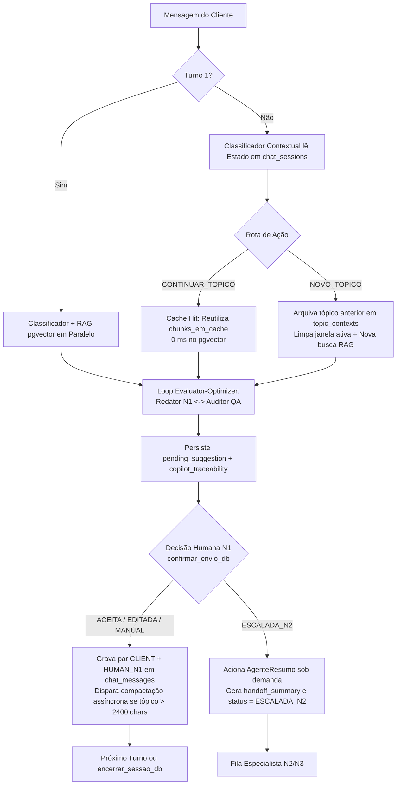

# Documentação Técnica — Arquitetura de Memória, Orquestração Multi-Turno e Suíte de Avaliação

**Projeto:** NexusTech Support Copilot  
**Frente:** Pipeline Multi-Agente, Persistência PostgreSQL (`pgvector` + `JSONB`), Fluxo Multi-Turno e Benchmark de Modelos  
**Escopo deste documento:** Detalhar as decisões arquiteturais, a modelagem de memória de curto e longo prazo, o mecanismo de continuidade e troca de tópico, a infraestrutura de resiliência e a metodologia experimental (Juiz Duplo em paralelo) adotada para validação e seleção de modelos.

---

## 1. Visão Geral e Evolução Arquitetural

O **NexusTech Support Copilot** opera no paradigma **Human-in-the-Loop (HITL)** para suporte B2B de Nível 1 (N1). Em vez de responder ou escalar chamados de forma totalmente autônoma, a pipeline multi-agente atua como copiloto: recupera procedimentos oficiais, gera uma sugestão auditada e emite alertas de escalonamento para o operador humano, que mantém a decisão final de aceitar, editar, reescrever ou escalar o atendimento.

Durante o amadurecimento da arquitetura, quatro mudanças estruturais foram consolidadas a partir de evidências empíricas:

1. **Quebra do ciclo em sugestão e confirmação (`HITL`):** Separação explícita entre a geração da proposta pela IA (`gerar_sugestao_db`) e a efetivação pelo atendente (`confirmar_envio_db`). Nenhuma resposta da IA é gravada no histórico oficial da conversa antes da ação humana.
2. **Reestruturação de responsabilidades entre agentes:**
   * **`AgenteClassificador`:** Deixou de decidir escalonamento automático (campo `initial_level` mantido apenas por retrocompatibilidade). Passou a concentrar-se no roteamento conversacional (`CONTINUAR_TOPICO` vs. `NOVO_TOPICO`, `is_followup`, `search_query`) e na classificação de categoria/prioridade para análise de BI.
   * **`AgenteResumo` (novo papel duplo):** Introduzido para atuar em dois momentos sem adicionar latência no caminho feliz do N1 — compactação assíncrona de tópicos extensos em background e geração sob demanda do dossiê executivo de handoff (`handoff_summary`) exclusivamente quando o operador escala para N2/N3.
   * **`AgenteRedatorN1` e `AgenteAuditorQualidade`:** Mantiveram suas responsabilidades centrais em loop *Evaluator-Optimizer* (redação ancorada no manual vs. auditoria de fidelidade, detecção de alucinação e recomendação exclusiva de `requer_escalonamento`). O prompt do Redator recebeu uma diretriz enxuta de continuidade conversacional para evitar reiniciar o diálogo em turnos subsequentes.
3. **Remoção do filtro rígido de categoria (`category_filter`) na busca RAG:** Com uma base atual de 30 manuais vetorizados, o ganho de latência do filtro por categoria no `pgvector` mostrou-se irrelevante frente ao efeito cascata provocado por eventuais erros de triagem (como classificar uma dúvida de 2FA como `Technical` ou desconto para ONG como `Billing`), que forçavam retorno `FORA_DE_ESCOPO`. A busca passou a ser aberta em todos os 30 documentos (`category_filter=None`), mantendo a classificação salva para BI. Em cenários futuros com bases vetoriais massivas e classificador de altíssima precisão, a reativação do pré-filtro continua suportada pelo `retriever.py`.
4. **Centralização de LLMs e resiliência operacional:** Criação da fábrica `src/agents/llm_factory.py` (permitindo parametrizar modelo, `max_tokens`, `timeout` e `enable_thinking` por agente) e do wrapper `src/agents/retry.py` (tolerância a quedas de DNS/rede e erros 5xx da API NVIDIA NIM).

---

## 2. Arquitetura de Memória e Gestão de Estado (PostgreSQL + `pgvector`)

### 2.1. Fundamentação Teórica e Referências

O desenho da memória foi estruturado a partir de quatro referências consolidadas na engenharia de agentes de linguagem, adaptadas aos requisitos de baixa latência, governança e auditabilidade de um atendimento empresarial:

| Referência | Conceito Central | Aplicação no NexusTech Support Copilot |
| :--- | :--- | :--- |
| **CoALA** (*Cognitive Architectures for Language Agents*, Sumers et al., 2023) | Separação da memória do agente em **Memória de Trabalho**, **Memória Episódica** e **Memória Semântica**. | Mapeamento direto em tabelas distintas no PostgreSQL: `chat_sessions` (trabalho), `chat_messages` (episódica) e `langchain_pg_embedding` (semântica). |
| **MemGPT / Letta** (*Towards LLMs as Operating Systems*, Packer et al., 2023) | Hierarquia de memória em camadas (contexto quente limitado na janela do LLM vs. armazenamento externo persistente com paginação/resumo). | Manutenção de estado quente enxuto em `chat_sessions` (`chunks_em_cache`, `topic_contexts`), delegando o histórico completo ao banco e compactando trechos extensos. |
| **Anthropic** (*Building Effective Agents* & *Effective Context Engineering*) | Padrão *Evaluator-Optimizer* e mitigação de *context rot* (degradação de atenção em janelas poluídas ou longas) via compactação e recuperação *just-in-time*. | Loop Redator $\leftrightarrow$ Auditor, isolamento da janela ativa em trocas de tópico e compactação assíncrona em background via `AgenteResumo`. |
| **Stateful Checkpointing & HITL** (LangGraph / Arquiteturas Transacionais) | Persistência explícita de estado entre turnos, separando rascunhos especulativos da IA do estado oficial validado. | Uso de `pending_suggestion` até a confirmação humana; promoção atômica para `chat_messages` apenas via `confirmar_envio_db`. |

---

### 2.2. Modelagem das 4 Tabelas no Cluster PostgreSQL

Optou-se por unificar o armazenamento relacional (`JSONB` + tabelas transacionais) e vetorial (`pgvector`) no **mesmo cluster PostgreSQL**. Essa decisão reduz a complexidade operacional no ambiente local (um único container Docker `pgvector/pgvector:pg16`), simplifica transações atômicas e prepara a migração direta para Amazon RDS/Aurora PostgreSQL com suporte a multi-tenancy (`tenant_id`).

| Tabela | Papel na Memória | Conteúdo Principal | Ciclo de Vida |
| :--- | :--- | :--- | :--- |
| **`langchain_pg_embedding`** | **Memória Semântica** (Base de Conhecimento) | Vetores de embedding e conteúdo original dos 30 manuais técnicos oficiais. | Permanente (leitura vetorial via `pgvector`). |
| **`chat_sessions`** | **Memória de Trabalho** (Contexto Quente) | `status`, `turno_global`, `turnos_no_topico_atual`, `categoria_atual`, `chunks_em_cache` (`JSONB`), `topic_contexts` (`JSONB`), `pending_suggestion` (`JSONB`), `handoff_summary`. | Mutável durante a sessão; **higienizado ao encerrar** (`encerrar_sessao_db`). |
| **`chat_messages`** | **Memória Episódica** (Histórico Oficial) | Transcrição oficial efetivamente trocada (`CLIENT`, `HUMAN_N1`, `SYSTEM`), `turn_number`, `topic_category` e `chunk_id`. | Persistente (*append-only*). Índice composto `(session_id, topic_category, turn_number)`. |
| **`copilot_traceability`** | **Auditoria & Feedback HITL** | `ai_suggested_text`, `human_final_text`, `human_action`, `atendente_id`, `was_edited`, `edit_ratio`, telemetria de tempos e snapshot integral `caixa_completa` (`JSONB`). | Persistente (BI, auditoria e curadoria para evolução autônoma). |

#### Princípio da "Verdade Conversacional" e Cálculo de Edição HITL
Se a IA redigir uma sugestão imprecisa e o atendente N1 corrigir o texto antes do envio, o sistema grava em `chat_messages` **exclusivamente a versão final validada pelo humano** (`human_final_text`). Isso impede que um erro da IA no Turno 1 contamine o contexto dos Turnos 2 e 3.

Em paralelo, `copilot_traceability` preserva o rascunho original da IA e calcula de forma determinística o grau de intervenção humana via `difflib.SequenceMatcher`:

* `was_edited`: booleano verdadeiro quando o texto normalizado final difere do texto sugerido.
* `edit_ratio`: distância normalizada no intervalo $[0.0, 1.0]$, onde $0.0$ indica aceitação integral e $1.0$ indica reescrita completa:

$$\text{edit\_ratio} = 1.0 - \text{similarity}(\text{ai\_suggested\_text},\ \text{human\_final\_text})$$

#### Higiene de Sessão (`encerrar_sessao_db`)
Ao finalizar um atendimento (resolvido em N1 ou após handoff N2), `encerrar_sessao_db(session_id, tenant_id)` marca `status = "ENCERRADA"`, registra `closed_at` e zera os campos voláteis de `chat_sessions` (`chunks_em_cache = NULL`, `topic_contexts = NULL`, `pending_suggestion = NULL`). Os logs imutáveis em `chat_messages` e a rastreabilidade em `copilot_traceability` permanecem intactos para auditoria e análise.

---

## 3. Orquestração e Dinâmica Multi-Turno

A orquestração é centralizada na classe `NexusSupportPipeline` (`src/pipeline_agents.py`), que expõe a fachada persistida (`gerar_sugestao_db`, `confirmar_envio_db`, `encerrar_sessao_db`, `aguardar_background`, `shutdown`) apoiada pelo `SessionRepository` (`src/db/session_repo.py`).

### 3.1. Ciclo Completo de uma Conversa Multi-Turno



### 3.2. Mecanismos-Chave de Baixa Latência e Continuidade

* **Paralelismo no Turno 1 (`_triagem_e_rag_turno1_paralelo`):** No primeiro contato de uma sessão, não há histórico prévio para aguardar reescrita de query. A pipeline dispara o `AgenteClassificador` e a busca semântica no `pgvector` simultaneamente via `ThreadPoolExecutor`, escondendo o custo de I/O do retrieval sob o tempo de inferência da triagem.
* **Cache de Manual por Tópico (`CONTINUAR_TOPICO`):** Quando o Classificador identifica continuidade (`is_followup = True`), a pipeline reutiliza diretamente `chunks_em_cache` persistido em `chat_sessions`, zerando a latência de `pgvector` e evitando que pequenas variações de vocabulário do cliente troquem o procedimento no meio do atendimento.
* **Isolamento e Retorno de Tópico (`NOVO_TOPICO` + `topic_contexts`):** Em conversas reais, clientes frequentemente abrem um assunto paralelo (ex.: *Technical* $\rightarrow$ *Billing* $\rightarrow$ *Technical*). Ao detectar `NOVO_TOPICO`:
  1. O estado e o histórico/resumo do tópico anterior são arquivados sob sua chave em `topic_contexts`.
  2. A janela de histórico injetada no Redator e no Auditor é isolada para o novo assunto, evitando mistura de políticas entre manuais distintos.
  3. Caso o cliente retorne ao assunto original em turnos posteriores, o contexto salvo em `topic_contexts` é restaurado, permitindo continuar sem repetir passos já executados.
* **Compactação Assíncrona em Background:** Quando o volume textual do tópico ativo ultrapassa o limiar (`MAX_CHARS_TOPICO = 2400`) ou ocorre troca de assunto, a pipeline submete o `AgenteResumo` ao `ThreadPoolExecutor` interno. A compactação roda fora do caminho crítico da resposta ao atendente e atualiza `topic_contexts` no PostgreSQL. Em testes determinísticos utiliza-se `pipeline.aguardar_background()`, e no desligamento do servidor chama-se `pipeline.shutdown(wait_pending=True)`.
* **Handoff Sob Demanda:** Durante turnos comuns do N1, o `AgenteResumo` não é invocado de forma síncrona (economia direta de ~1s a 2s por turno). Ele só executa no fluxo síncrono quando `acao_humana == "ESCALADA_N2"`, consolidando todo o histórico oficial de `chat_messages` em um dossiê estruturado (`handoff_summary`) para o especialista.

### 3.3. Fábrica de LLMs e Resiliência (`llm_factory.py` e `retry.py`)

* **`src/agents/llm_factory.py`:** Centraliza a instanciação de `crewai.LLM` via `criar_llm(model_spec, temperature)` e `resolver_config(...)`. Aceita tanto strings simples quanto dicionários com `model`, `enable_thinking`, `max_tokens` e `timeout`. Quando `enable_thinking` é definido explicitamente, injeta `extra_body={"chat_template_kwargs": {"enable_thinking": bool}}` diretamente na chamada compatível com a NVIDIA NIM.
* **`src/agents/retry.py`:** Todos os quatro agentes e os avaliadores executam via `executar_crew_com_retry(crew, max_tentativas=3, espera_s=2.0)`. A camada diferencia erros irrecuperáveis (`400, 401, 403, 404, 410, 422`) de falhas transitórias; ao detectar perda de conexão ou falha de DNS (`[Errno -3] Temporary failure in name resolution`), chama `aguardar_conexao()`, pausando silenciosamente até `integrate.api.nvidia.com:443` voltar a responder antes de retentar.
* **Parsers Determinísticos:** A limpeza de blocos `<think>...</think>` e a extração da citação interna `[[FONTE: MAN-...]]` são feitas em Python via regex. A tag interna é removida da mensagem exibida ao cliente e armazenada em `fonte_tecnica_citada` para auditoria e rastreabilidade.

---

## 4. Suíte de Testes e Metodologia de Avaliação (`src/eval/`)

A estratégia de validação foi dividida em **quatro camadas complementares**, permitindo validar integridade de software sem custo de API, medir compatibilidade bruta de modelos, avaliar dinâmica conversacional multi-turno e realizar comparação estatística isolada por agente.

### 4.1. Camada 1 — Testes Unitários e de Integração (`pytest`)

Localizados em `tests/`, validam contratos Pydantic, persistência relacional e fluxo da pipeline sem depender de chamadas externas à LLM:
* `tests/test_db_repo.py`: criação de tabelas, ciclo de vida de sessões, gravação de mensagens, cálculo de `edit_ratio`, filas de atendente/especialista e higiene ao encerrar.
* `tests/test_pipeline_db.py`: integração da `NexusSupportPipeline` com `SessionRepository`, paralelismo no Turno 1 e compactação assíncrona.
* `tests/test_multiturn.py`: validação dos schemas `AtendimentoRedatorSchema` e `CaixaRastreabilidadeSchema`, troca de tópico e isolamento de histórico.

### 4.2. Camada 2 — Sondagem Técnica de Modelos NVIDIA NIM (`probe_models.py` e `probe_adaptacao.py`)

Antes de montar presets de benchmark, os modelos disponíveis na conta NVIDIA NIM foram submetidos a dois scripts de sondagem:
1. **`probe_models.py`:** valida compatibilidade simultânea com a API OpenAI e com o `crewai.LLM`, verificando adesão a JSON estrito e detecção de modelos que devolvem `content` vazio quando usam `reasoning_content`.
2. **`probe_adaptacao.py`:** mede diretamente o impacto de `enable_thinking=True` vs. `False` em latência, tamanho do raciocínio (`reasoning_len`) e integridade do JSON.

#### Resultados do Probe de Adaptação (`logs/probe_adaptacao_nim.json`)

| Modelo NVIDIA NIM | Modo | Status | Latência | JSON Válido | `reasoning_len` | Decisão |
| :--- | :--- | :---: | :---: | :---: | :---: | :--- |
| `nvidia/nemotron-3.5-lightning-30b-a3b` | `thinking=True` | OK | `6,59s` | Sim | 2.994 | Alto custo de tempo/tokens |
| `nvidia/nemotron-3.5-lightning-30b-a3b` | `thinking=False` | OK | **`0,61s`** | Sim | 0 | **Aprovado (corte de ~10x)** |
| `nvidia/nemotron-3-nano-omni-30b-a3b-reasoning` | `thinking=False` | OK | **`0,53s`** | Sim | 0 | Testado; descartado depois por baixa acurácia no Classificador |
| `nvidia/nemotron-3.5-super-vl-120b-a12b` | `thinking=True` | OK | `2,07s` | Sim | 785 | Testado no Auditor; instável em contextos longos |
| `nvidia/nemotron-3.5-super-vl-120b-a12b` | `thinking=False` | OK | **`1,05s`** | Sim | 0 | **Aprovado (Redator, Auditor, Juiz Cliente)** |
| `nvidia/nemotron-3-ultra-550b-a55b` | `thinking=False` | OK | **`2,53s`** | Sim | 0 | **Aprovado (Classificador preciso / Auditor autônomo)** |
| `moonshotai/kimi-k3.1-pro` | `thinking=False` / padrão | OK | `29,47s` – `32,19s` | Sim | 0 / 335 | Descartado (fora do orçamento de tempo real) |
| `mistralai/mistral-large-4-1t-a52b` | padrão | OK | `153,11s` | Sim | 4.367 | Descartado (inviável para chat) |
| `z-ai/glm-5.3-flash` | `thinking=False` | Erro | `272,46s` | — | — | Descartado (`APITimeoutError`) |

---

### 4.3. Camada 3 — Arquitetura de Juiz Duplo em Paralelo (`src/eval/judge.py`)

Durante os pilotos iniciais, uma avaliação única revelou-se insuficiente para distinguir **qualidade técnica** de **experiência do usuário**:
* Um modelo simpático que improvisa passos fora do manual recebia nota máxima na percepção de atendimento (**Cliente 10/10**), mas falhava gravemente em governança (**Técnico 0/10**).
* Um modelo que escala no Turno 1 sem orientar ou ouvir o cliente podia atender ao gabarito final de escalonamento (**Técnico 10/10**), mas gerava forte frustração (**Cliente 4/10**).

Para capturar essas duas dimensões sem dobrar o tempo de avaliação, implementou-se `AvaliadorDuplo`, que executa dois juízes simultaneamente via `ThreadPoolExecutor(max_workers=2)`:

| Dimensão | Juiz Técnico (QA / Auditoria) | Juiz Cliente (UX / CSAT) |
| :--- | :--- | :--- |
| **Modelo** | `nvidia/nemotron-3-ultra-550b-a55b` (`thinking=True`, `max_tokens=4096`) | `nvidia/nemotron-3.5-super-vl-120b-a12b` (`thinking=False`, `max_tokens=1024`) |
| **O que enxerga** | Pergunta/transcrição, manual base recuperado, `FONTE_EXTRAIDA` pelo parser, gabarito de escalonamento e `handoff_summary`. | **Apenas** a pergunta/transcrição final entregue ao cliente (sem manual, sem tags internas e sem metadados de auditoria). |
| **Rubrica Single-Turn (0–2 pts cada, total 10)** | `fidelidade_manual`, `ausencia_alucinacao`, `citacao_fonte`, `coerencia_escalonamento`, `aderencia_escopo`. | `empatia_tom`, `clareza_passos`, `utilidade_pratica`, `sem_jargao_interno`, `satisfacao_geral`. |
| **Rubrica Multi-Turn (0–2 pts cada, total 10)** | `memoria_isolamento`, `nao_repeticao_n1`, `ausencia_alucinacao`, `timing_escalonamento`, `qualidade_handoff`. | `empatia_tom`, `sensacao_de_ser_ouvido`, `clareza_conducao`, `sem_jargao_interno`, `satisfacao_geral`. |

*Nota de calibração:* O critério `citacao_fonte` instrui explicitamente o Juiz Técnico a avaliar apenas o campo `FONTE_EXTRAIDA`, pois o parser remove a tag `[[FONTE: ...]]` antes de exibir a mensagem ao cliente.

---

### 4.4. Camada 4 — Persistência, Checkpoint e Baterias Multi-Turno vs. Single-Turn

Todos os resultados de benchmark são persistidos no PostgreSQL em duas tabelas dedicadas em `src/db/models.py`:
* **`eval_results`:** chave única `uq_eval_exp_case_run` em `(experiment_id, case_id, run_index)`. Armazena métricas de triagem, escalonamento, auditoria, telemetria, notas/justificativas dos dois juízes e `caixa_completa` (`JSONB`).
* **`eval_multiturn_results`:** chave única `uq_eval_mt_exp_scen_run` em `(experiment_id, scenario_id, run_index)`. Armazena total de turnos, `cache_hits`, latência média/total, transcrição completa, `handoff_summary`, `turnos_detalhe` (`JSONB`) e notas/justificativas dos dois juízes.

Ambas implementam **checkpoint automático**: em caso de interrupção ou queda prolongada de rede, reexecutar o comando pula imediatamente os itens já salvos e retoma do ponto exato. Cada iteração é envolvida por `try/except` com `aguardar_conexao()` para que uma falha isolada nunca interrompa uma bateria noturna.

#### Por que separar Multi-Turno e Single-Turn?

| Aspecto | Bateria Multi-Turno (`runner_multi_turn.py`) | Bateria Single-Turn (`runner_single_turn.py`) |
| :--- | :--- | :--- |
| **Escopo e Volume** | **6 cenários $\times$ 3 runs** (18 conversas/preset) com `ClienteSimuladorLLM` (`super-vl-120b`, `thinking=False`). | **68 casos $\times$ 5 runs** (340 execuções/preset) via `data/evaluation/testes_benchmark.json` (30 EN + 30 PT canônicos + 8 bordas N2). |
| **O que observa** | Dinâmica conversacional real: retenção de memória, cache hit, não-repetição de passos N1, troca/retorno de tópico (`MT-SWITCH-01`), timing de escalonamento e qualidade do handoff. | Desempenho estatístico isolado de cada papel (Classificador, RAG, Redator e Auditor) em português e inglês, sem contaminação ou variância acumulada entre turnos. |
| **Como afeta o projeto** | Orienta ajustes de arquitetura de memória, roteamento de tópico, prompts de continuidade e experiência do usuário. | Define com rigor estatístico qual modelo performa melhor em cada agente, valida o limiar `MIN_SIMILARITY` sem `category_filter` e separa o perfil ideal de **Copiloto HITL** vs. **futuro Autônomo**. |

#### Cenários da Bateria Multi-Turno (`CENARIOS_MULTITURN`)
1. `MT-TECH-01` (`Technical`): Travamento de dashboard; cliente executa passos N1 e problema persiste > 30 min $\rightarrow$ escalar N2.
2. `MT-BILL-01` (`Billing`): Falha ao atualizar cartão Visa mesmo com liberação confirmada no banco $\rightarrow$ escalar N2.
3. `MT-ACCO-01` (`Account`): Troca de e-mail com perda de aparelho 2FA e sem códigos de backup $\rightarrow$ escalar N2.
4. `MT-FRAU-01` (`Fraud`): Suspeita de invasão; botão de bloqueio não aparece mesmo com e-mail validado $\rightarrow$ escalar N2.
5. `MT-GENE-01` (`General Inquiry`): Desconto para ONG e dúvidas complementares $\rightarrow$ resolução integral em N1 (`expected_escalation = False`).
6. `MT-SWITCH-01` (`Technical` $\rightarrow$ `Billing` $\rightarrow$ `Technical`): Troca de assunto no Turno 2 e retorno ao problema original no Turno 3 validando isolamento e restauração de memória.

---

## 5. Achados Empíricos e Evolução dos Presets

### 5.1. Resultados Consolidados da Rodada Multi-Turno (v1 — 4 Presets)

| Experimento / Preset | Conversas Concluídas | Falhas (`EmptyLLM`) | Acc. Escalonamento | Nota Técnico (std) | Nota Cliente | Latência Média / P95 por Turno |
| :--- | :---: | :---: | :---: | :---: | :---: | :---: |
| **`mt_copilot_off`** (`copilot_fast_thinking_off`) | **18/18** | **0** | **94,4%** | **9,39** (`1,20`) | 7,06 | **19,97s** / 33,12s |
| **`mt_copilot_hibrido`** (`copilot_hibrido`) | 14/18 | 4 | 71,4% | 8,50 (`1,74`) | 8,00 | 37,26s / 57,76s |
| **`mt_autonomo`** (`autonomo_max_qualidade`) | 16/18 | 2 | 68,8% | 8,56 (`2,25`) | 7,62 | 74,66s / 194,18s |
| **`mt_baseline_on`** (`baseline_thinking_on`) | 2/18 | **16** | 50,0% | 7,00 (`2,83`) | 7,50 | 38,93s / 42,07s |

### 5.2. Principais Diagnósticos Extraídos das Transcrições

1. **Inviabilidade de `thinking=True` em operação interativa:** Modelos com raciocínio ativado consumiram o limite de `2048` tokens dentro de `reasoning_content`, retornando `content` vazio (`EmptyLLMResponseError` em 16/18 execuções do baseline e 3/3 do cenário mais longo `MT-SWITCH-01` no híbrido). Mesmo elevando para `4096` tokens na v2, o perfil com raciocínio sofreu timeouts, latência P95 de `94,37s` e queda severa na acurácia de escalonamento.
2. **Efeito cascata do `category_filter`:** A inspeção do campo `turnos_detalhe` no PostgreSQL comprovou que quase todas as quedas de qualidade originavam-se na triagem — o `nano-omni-30b` classificou invasão de conta como `Account` (3/3) e manteve `Technical` na troca para cobrança duplicada (3/3); até o `ultra-550b` classificou desconto para ONG como `Billing` (3/3). Ao remover `category_filter` na busca vetorial, o sanity check bilíngue (`CAN-EN-01` e `CAN-PT-01`) recuperou o manual exato (`MAN-ACCO-001-SEC-01`) mesmo com erro de categoria, saltando de **`0/10` para `8–9/10` no Técnico e `10/10` no Cliente**.
3. **Correções no simulador multi-turno:** A inspeção das transcrições identificou duas distorções experimentais corrigidas no `runner_multi_turn.py`: (a) encerramento precoce quando o simulador incluía `[ENCERRAR]` na mesma fala em que pedia uma ação — resolvido com trava determinística; (b) vazamento do termo `"N2"` no roteiro do cliente simulado — substituído por `"equipe especializada"`.
4. **Prioridade de latência no modelo HITL:** Como o atendente humano atua como avaliador e editor final, presets rápidos com `thinking=False` entregam melhor relação operacional. As correções registradas em `copilot_traceability` formam o dataset real para refinar o sistema até a maturidade de operação autônoma.

### 5.3. Desenho Experimental da Bateria Single-Turn (`src/eval/presets.py`)

Para isolar o impacto individual de cada agente na bateria Single-Turn (`68 casos × 5 runs`, sem `category_filter` e 100% `thinking=False`), os presets foram desenhados em degraus de uma única variável:

| Preset | Classificador | Redator | Auditor | Resumo | Variável Isolada |
| :--- | :--- | :--- | :--- | :--- | :--- |
| **`copilot_fast`** | `lightning-30b` (OFF) | `lightning-30b` (OFF) | `super-vl-120b` (OFF) | `bolt-e4b` | Referência de velocidade máxima (HITL) |
| **`copilot_preciso`** | **`ultra-550b` (OFF)** | `lightning-30b` (OFF) | `super-vl-120b` (OFF) | `bolt-e4b` | Isola ganho no **Classificador** (`lightning-30b` vs. `ultra-550b`) |
| **`copilot_redator_super`** *(opcional)* | `ultra-550b` (OFF) | **`super-vl-120b` (OFF)** | `super-vl-120b` (OFF) | `bolt-e4b` | Isola ganho no **Redator** (`lightning-30b` vs. `super-vl-120b`) |
| **`autonomo_fast`** | `ultra-550b` (OFF) | `super-vl-120b` (OFF) | **`ultra-550b` (OFF)** | `super-vl-120b` (OFF) | Isola ganho no **Auditor** (perfil candidato a modo autônomo) |

### 5.4. Consolidação Final da Bateria Single-Turn (`68 × 5`) — *Espaço para Preenchimento Pós-Execução*

> *Preencher após a conclusão da execução em andamento via `venv/bin/python -m src.eval.relatorio --modo single --csv logs/relatorio_single_overnight.csv`.*

| Experimento | Execuções | Acc. Categoria (EN / PT) | Acc. Escalonamento | Aprovação Auditor | Nota Técnico (std) | Nota Cliente | Latência P50 / P95 |
| :--- | :---: | :---: | :---: | :---: | :---: | :---: | :---: |
| `st_v2_fast` (`copilot_fast`) | _/340 | _% | _% | _% | _/10 (_) | _/10 | _s / _s |
| `st_v2_preciso` (`copilot_preciso`) | _/340 | _% | _% | _% | _/10 (_) | _/10 | _s / _s |
| `st_v2_redator_super` *(se rodado)* | _/340 | _% | _% | _% | _/10 (_) | _/10 | _s / _s |
| `st_v2_autonomo` (`autonomo_fast`) | _/340 | _% | _% | _% | _/10 (_) | _/10 | _s / _s |

---

## 6. Guia Operacional e Comandos de Reprodução

### 6.1. Banco de Dados e Testes de Integração (`pytest`)

```bash
# Subir PostgreSQL + pgvector
docker-compose up -d

# Criar tabelas operacionais e de benchmark via SQLAlchemy
venv/bin/python -c "from src.db.connection import criar_tabelas; criar_tabelas(); print('Tabelas criadas')"

# Executar suíte de testes de integração sem custo de LLM
venv/bin/python -m pytest tests/test_db_repo.py tests/test_pipeline_db.py -v -p no:warnings
```

### 6.2. Geração do Dataset Bilíngue e Execução dos Benchmarks

```bash
# Gerar data/evaluation/testes_benchmark.json (30 EN + 30 PT + 8 bordas N2)
venv/bin/python -m src.eval.gerar_dataset_benchmark

# Executar bateria Multi-Turno (exemplo em background com log ao vivo)
PYTHONUNBUFFERED=1 nohup bash -c '
venv/bin/python -u -m src.eval.runner_multi_turn --exp mt_v2_copilot_fast --preset copilot_fast --runs 3 --sleep 2.0 &&
venv/bin/python -u -m src.eval.runner_multi_turn --exp mt_v2_copilot_preciso --preset copilot_preciso --runs 3 --sleep 2.0
' > logs/eval_multiturn_v2.log 2>&1 &

# Executar bateria Single-Turn (68 casos x 5 repetições)
PYTHONUNBUFFERED=1 nohup bash -c '
venv/bin/python -u -m src.eval.runner_single_turn --exp st_v2_fast --preset copilot_fast --dataset data/evaluation/testes_benchmark.json --runs 5 --sleep 2.0 &&
venv/bin/python -u -m src.eval.runner_single_turn --exp st_v2_preciso --preset copilot_preciso --dataset data/evaluation/testes_benchmark.json --runs 5 --sleep 2.0 &&
venv/bin/python -u -m src.eval.runner_single_turn --exp st_v2_autonomo --preset autonomo_fast --dataset data/evaluation/testes_benchmark.json --runs 5 --sleep 2.5
' > logs/eval_single_overnight.log 2>&1 &
```

### 6.3. Extração de Relatórios e Inspeção Detalhada

```bash
# Resumo estatístico + exportação CSV (Single-Turn e Multi-Turn)
venv/bin/python -m src.eval.relatorio --modo single --csv logs/relatorio_single.csv
venv/bin/python -m src.eval.relatorio --modo multi --csv logs/relatorio_multiturn.csv

# Inspeção completa de respostas, raciocínio do Auditor e justificativas dos dois Juízes
venv/bin/python -m src.eval.relatorio --modo single --exp st_v2_fast --detalhe --limit 10
venv/bin/python -m src.eval.relatorio --modo multi --exp mt_copilot_off --detalhe --limit 10
```

---

## 7. Referências Bibliográficas e Técnicas

1. **Sumers, T. R., Yao, S., Narasimhan, K., & Griffiths, T. L. (2023).** *Cognitive Architectures for Language Agents (CoALA).* arXiv:2309.02427.
2. **Packer, C., Wooders, S., Lin, K., Fang, V., Patil, S. G., Stoica, I., & Gonzalez, J. E. (2023).** *MemGPT: Towards LLMs as Operating Systems.* arXiv:2310.08560.
3. **Anthropic Engineering (2024–2025).** *Building Effective Agents* e *Effective Context Engineering for AI Agents.*
4. **LangGraph Documentation.** *Persistence, Checkpointing & Human-in-the-Loop Architectures.*