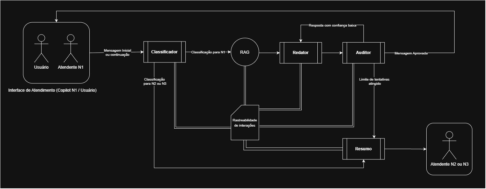

# Entrega 1.2, 1.3 e 1.4 — Arquitetura de Agentes, Mapeamento de Dados e Stack Técnico

**Projeto:** NexusTech Support Copilot (Problema 1)  
**Empresa Fictícia:** NexusTech Solutions (SaaS B2B — ERP em Nuvem)  
**Referência Base:** *Designing Multi-Agent Systems: Principles, Patterns, and Implementation for AI Agents* — Victor Dibia

---

## 1. Proposta de Arquitetura de Agentes (Entregável 1.2)

### 1.1 Padrão de Orquestração e Motivação Técnica
Com base nos padrões de sistemas multi-agentes de Victor Dibia (Capítulos 2 e 6 — *Workflows as Computational Graphs*), adotamos o padrão **Workflow Determinístico em Grafo Cíclico com Roteamento Condicional**.

**Motivação Técnica:**
* Em operações de suporte corporativo (N1 a N3) com meta de reduzir o TMA de 12 minutos para menos de 4 minutos, fluxos puramente conversacionais ou autônomos abertos geram latência imprevisível e risco de alucinação.
* Ao modelar o sistema como uma máquina de estados determinística, garantimos que toda interação passe obrigatoriamente por triagem, recuperação semântica e auditoria de qualidade, permitindo ciclos controlados apenas para refinamento de resposta ou continuação de conversa dentro de limites estritos.

---

### 1.2 Os Agentes do Sistema, Suas Responsabilidades e a Ferramenta RAG

A arquitetura é composta por **4 Agentes Especializados** (nós baseados em LLM) e **1 Ferramenta/Nó Determinístico de Recuperação (RAG)** que se comunicam lendo e escrevendo em uma estrutura centralizada chamada **Caixa de Rastreabilidade de Interações (Shared State)**:

| # | Agente | Responsabilidade Principal | O que Lê do Estado | O que Escreve na Rastreabilidade |
| :-: | :--- | :--- | :--- | :--- |
| **1** | **Agente Classificador** (`Triage & Context Agent`) | Analisa a mensagem inicial ou de continuação no chat. Identifica se é uma dúvida única/nova ou continuação do mesmo problema, classifica na taxonomia unificada (`categoria`, `prioridade`) e define o nível sugerido (`N1`, `N2` ou `N3`). | `historico_mensagens`, mensagem atual, classificação anterior e contador de turnos do usuário. | `intent_type` (`NEW_TOPIC` ou `FOLLOW_UP`), `categoria`, `prioridade`, `nivel_atendimento` (`N1`/`N2`/`N3`) e `search_query`. |
| **2** | **Agente Redator / Agregador** (`Support Writer Agent`) | Redige a sugestão de resposta ancorada nos procedimentos do Manual Oficial e no tom dos exemplos do Bitext recuperados pela ferramenta RAG. Cita obrigatoriamente os `documentos_id` utilizados ou sinaliza falta de informação na base. | Mensagem do usuário, `retrieved_chunks` (vindos da ferramenta RAG) e eventual `feedback_auditor` (em caso de reescrita). | `rascunho_atual`, `cited_doc_ids` e flag `missing_knowledge`. |
| **3** | **Agente Auditor** (`QA & Escalation Critic`) | Atua como *Guardrail* antes de exibir a mensagem ao Usuário / Atendente N1. Verifica se a resposta resolve a dúvida, se há alucinação (delírio fora dos chunks recuperados pelo RAG) e controla os limites de tentativas. | `rascunho_atual`, `retrieved_chunks`, `tentativas_auditor` e contador de turnos do chat. | `confianca_score`, `status_auditoria` (`APPROVED`, `RETRY_DRAFT`, `ESCALATE`), `tentativas_auditor + 1` e `feedback_auditor`. |
| **4** | **Agente de Resumo** (`Handoff Summarizer Agent`) | Acionado exclusivamente quando um chamado é escalado para **N2 ou N3** (seja direto pelo Classificador ou após reprovação/limite no Auditor). Gera um briefing executivo para o especialista humano. | Registro completo da **Caixa de Rastreabilidade de Interações**. | `status_final` (`ESCALATED_N2` ou `ESCALATED_N3`), `motivo_escalonamento` e `resumo_handoff` (o que foi pedido + o que o Copilot já tentou). |

#### Ferramenta de Recuperação Semântica (RAG — `Knowledge Retriever Tool / Node`)
Diferente dos agentes acima — que utilizam raciocínio de LLM para classificar, redigir, auditar ou resumir —, o **RAG** opera como uma **Ferramenta de Busca (Nó Determinístico de Execução)** posicionada entre o **Agente Classificador** e o **Agente Redator / Agregador**:
* **Como funciona no fluxo:** Quando o Agente Classificador define que o chamado é elegível para atendimento em **N1**, o grafo aciona a ferramenta de RAG. Ela lê a `search_query` e a `categoria` diretamente da **Caixa de Rastreabilidade**.
* **Operação no Banco de Vetores:** A ferramenta converte a query em embedding e executa uma busca vetorial híbrida (com pré-filtro SQL pela `categoria`) em duas camadas no **PG Vector**: consulta primeiro os Manuais Oficiais da empresa (`kb_official_manuals`) e, complementarmente, a base de Tickets Históricos (`kb_historical_tickets`).
* **Registro na Rastreabilidade:** Sem consumir chamadas extras de LLM, a ferramenta grava na **Caixa de Rastreabilidade** os identificadores dos documentos encontrados (`documentos_id`, como `MANUAL-04` e `BTX-1092`), os trechos relevantes (`retrieved_chunks`) e seus respectivos scores de similaridade, disponibilizando esse contexto pronto para o **Agente Redator / Agregador**.

---

### 1.3 Fluxo de Orquestração (Sequencial, Condicional e Loops)

1. **Rota de Escalonamento Precoce (Classificador $\rightarrow$ Resumo $\rightarrow$ N2/N3):**
   * Se o **Agente Classificador** detectar um incidente crítico de infraestrutura/segurança (ex: Erro 500 de API, falha sistêmica ou alerta de fraude mapeados como **N3**), ou se o cliente na continuação da conversa já atingiu o limite de tentativas sem sucesso no N1, o fluxo desvia imediatamente para o **Agente de Resumo** e entrega o caso consolidado para o **Atendente N2/N3**.
2. **Fluxo Principal de Resolução N1 (Classificador $\rightarrow$ Ferramenta RAG $\rightarrow$ Redator $\rightarrow$ Auditor):**
   * Sendo um caso elegível para **N1**, a **Ferramenta RAG** busca no PG Vector os trechos do Manual Oficial + exemplos de tickets do Bitext, atualiza a Caixa de Rastreabilidade e passa o fluxo para o **Agente Redator / Agregador** construir a resposta citada.
3. **Loop Interno de Correção (Auditor $\rightarrow$ Redator):**
   * O **Agente Auditor** valida o rascunho. Se houver falha de formatação, omissão de citação ou baixa aderência ao documento recuperado, ele devolve o fluxo ao **Agente Redator** com instruções de ajuste, incrementando `tentativas_auditor`.
   * **Trava de Loop Infinito:** Se `tentativas_auditor` atingir o limite máximo configurado (ex: $3$ tentativas internas) ou se não houver informação suficiente retornada pelo RAG, a aresta condicional desvia obrigatoriamente para o **Agente de Resumo** $\rightarrow$ **Atendente N2/N3**.
4. **Loop Externo de Conversa Contínua (Bounded Multi-Turn):**
   * Se o **Auditor** aprovar a mensagem, ela é entregue ao **Usuário / Atendente N1**.
   * Caso o usuário envie uma nova mensagem no mesmo chat (2ª ou 3ª interação), ela reingressa no **Agente Classificador** mantendo o mesmo `session_ticket_id`. O Classificador avalia se o usuário mudou de assunto (novo ciclo N1) ou se continua com o mesmo problema não resolvido (incrementando o contador rumo ao escalonamento N2).

---

### 1.4 Diagrama de Arquitetura do Sistema

---

## 2. Mapeamento e Engenharia dos Dados (Entregável 1.3)

### 2.1 Análise Exploratória Real dos Datasets Recomendados
Inspecionamos os datasets propostos no treinamento para definir o papel exato de cada fonte na arquitetura:

1. **`Bitext_Sample_Customer_Support_Training_Dataset_27K_responses-v11.csv` (26.872 registros | 5 colunas):**
   * **Volume e Qualidade:** Base completa sem valores nulos, distribuída em **11 categorias** (`ACCOUNT`, `ORDER`, `REFUND`, `INVOICE`, `CONTACT`, `PAYMENT`, `FEEDBACK`, `DELIVERY`, `SHIPPING`, `SUBSCRIPTION`, `CANCEL`) e **27 intenções (`intent`)** com ~1.000 variações por intenção.
   * **Perfil de Texto:** Perguntas (`instruction`) curtas com média de 9 palavras (máx. 16 palavras) e respostas (`response`) procedurais com média de 105 palavras (máx. 402 palavras).
   * **Peculiaridade Técnica:** Contém 391 tipos de variáveis dinâmicas de template (ex: `{{Order Number}}`, `{{Online Company Portal Info}}`, `{{Customer Support Phone Number}}`).
2. **`customer_support_tickets.csv` — CRM Dataset (20.000 registros | 12 colunas):**
   * **Volume e Estrutura:** Contém metadados ricos de operação de suporte (`Ticket_ID`, `Issue_Category`, `Priority_Level`, `Ticket_Channel`, `Resolution_Time_Hours`, etc.) divididos em 5 categorias: `Technical` (5.918), `Billing` (5.036), `Account` (4.081), `General Inquiry` (3.925) e `Fraud` (1.040).
   * **Descoberta Crítica na Análise Exploratória:** Este dataset **não possui coluna de resposta/resolução** do suporte e suas descrições (`Ticket_Description`) são formadas por 30 templates de problemas reais seguidos de uma segunda frase sintética aleatória (*Lorem Ipsum*).
3. **`Customer Support Tickets Dataset (200K+ Records)`:**
   * **Observação:** O link referenciado para este dataset encontra-se indisponível ou foi removido da fonte original (Kaggle). O dataset foi descartado do escopo.

---

### 2.2 Tratamento, Limpeza (LGPD) e Papel de Cada Dataset

#### A. Dataset de Conhecimento e Exemplos Vetorizados (`Bitext 27K`) + Manuais Sintéticos
O dataset **Bitext** será a base fundamental do nosso **Banco de Vetores (PG Vector)**, operando em duas frentes:
* **Coluna Descartada:** `flags` (tags de anotação linguística/morfológica que não agregam valor operacional ao Agente Redator).
* **Colunas Mantidas como Metadados (`category`, `intent`):** Essenciais para o pré-filtro estruturado no banco vetorial. Se o Agente Classificador identificar um problema de Faturamento (`BILLING`), a ferramenta RAG filtra diretamente as categorias correspondentes (`INVOICE`, `PAYMENT`, `REFUND`) sem varrer todo o banco.
* **Colunas Vetorizadas e de Conteúdo (`instruction`, `response`):**
  1. **Camada 1 — Geração dos Manuais Oficiais da NexusTech (`kb_official_manuals`):** A partir das 27 intenções do Bitext, consolidaremos artigos canônicos de procedimentos internos substituindo os placeholders genéricos (como `{{Online Company Portal Info}}`) por dados padronizados da NexusTech Solutions. Será a **primeira fonte de verdade** consultada pela ferramenta RAG.
  2. **Camada 2 — Base Histórica de Tickets Resolvidos (`kb_historical_tickets`):** Os registros de pergunta e resposta do Bitext indexados com um identificador único de referência (`source_doc_id`, ex: `BTX-00124`) para que o Agente Redator recupere exemplos reais de estruturação de frase e mantenha o tom padronizado da empresa.

#### B. Dataset de Simulação de Entrada e Calibragem de Triagem (`customer_support_tickets.csv`)
Como este dataset não possui a resposta final do atendente, **ele não será indexado como resposta no banco vetorial**, mas cumprirá um papel fundamental como **Stream de Simulação de Chamados de Clientes e Calibragem do Agente Classificador**:
* **Colunas Descartadas (Conformidade LGPD e Ruído Operacional):** `Customer_Name`, `Customer_Email`, `Assigned_Agent`, `Submission_Date`, `Resolution_Time_Hours`, `Ticket_Channel`, `Satisfaction_Score`. Descartamos dados pessoais sensíveis (PII) em conformidade com a LGPD e métricas operacionais pós-atendimento que não agregam valor semântico à resolução técnica.
* **Limpeza de Texto (Data Cleaning):** Remoção automatizada via script da segunda sentença de *Lorem Ipsum* presente na coluna `Ticket_Description`.
* **Colunas Utilizadas nos Testes (`Ticket_Subject`, `Ticket_Description`, `Issue_Category`, `Priority_Level`):** Como o Bitext só possui dúvidas procedurais de N1, utilizaremos os chamados de categoria `Technical` (ex: *"500 Internal Server Error on API endpoint"*, *"App crashes"*) e `Fraud` (ex: *"Account compromised"*) com prioridade `Critical`/`High` deste CSV para testar e validar o **escalonamento automático para N2 e N3**.

---

### 2.3 Taxonomia Unificada de Categorias (De-Para entre Datasets e Classificador)

Para que o **Agente Classificador** e a **Ferramenta RAG** utilizem o mesmo contrato de metadados, estabelecemos o mapeamento unificado abaixo:

| Categoria Unificada (Classificador) | Categorias Mapeadas do `Bitext` | Categorias Mapeadas do `CRM Dataset` | Regra de Nível de Atendimento (`N1` / `N2` / `N3`) |
| :--- | :--- | :--- | :--- |
| **`ACCOUNT`** | `ACCOUNT`, `SUBSCRIPTION`, `CANCEL` | `Account` | **N1** (Criar/editar conta, recuperar senha, plano) ou **N2** (Perda de 2FA, bloqueio ou tentativa recorrente sem sucesso). |
| **`BILLING`** | `INVOICE`, `PAYMENT`, `REFUND` | `Billing` | **N1** (2ª via de fatura, política de reembolso, métodos de pagamento) ou **N2** (Cobrança duplicada, falha de estorno). |
| **`ORDERS_AND_LOGISTICS`** | `ORDER`, `SHIPPING`, `DELIVERY` | *(Coberto pelo Bitext)* | **N1** (Rastreio, status de pedido, alteração de endereço) ou **N2** (Exceções após limite de turnos no chat). |
| **`GENERAL_INQUIRY`** | `CONTACT`, `FEEDBACK` | `General Inquiry` | **N1** (Dúvidas gerais, feedbacks) ou **N2** (Quando a intenção for `contact_human_agent` / falar com atendente). |
| **`TECHNICAL_AND_SECURITY`** | *(Sem cobertura no Bitext — Gap intencional para escalonamento)* | `Technical`, `Fraud` | **N3 Direto** (Erros 500 de API, travamento de dashboard, falha de sincronização em nuvem, invasão de conta/fraude). |

---

## 3. Definição do Stack Técnico (Entregável 1.4)

### 3.1 Framework de Orquestração: LangGraph (Escolhido) vs. CrewAI
Escolhemos o **LangGraph** porque o nosso fluxo exige controle estrito de ciclos de auditoria, execução intercalada de nós de agentes e ferramentas determinísticas (RAG), além de gestão de estado tipada — requisitos essenciais para um ambiente de suporte corporativo onde rastreabilidade e segurança operacional são prioridades:

1. **Suporte Nativo a Ciclos e Grafos (Loops):** A arquitetura exige comportamento não-linear e cíclico, especificamente o loop de validação entre o Agente Redator e o Agente Auditor (onde o Auditor pode reprovar o rascunho e devolvê-lo para correção). O LangGraph modela nós e arestas condicionais (`conditional_edges`) com base na teoria de grafos, lidando com ciclos de forma nativa e matematicamente previsível, enquanto outros frameworks focam em fluxos lineares ou hierárquicos.
2. **Controle Determinístico e Previsibilidade:** Em suporte corporativo (N1–N3), a IA não pode agir de forma imprevisível. O LangGraph dá ao desenvolvedor controle total sobre o fluxo de execução através de funções de decisão, sabendo-se exatamente em qual nó o fluxo está e para onde vai a seguir.
3. **Gestão de Estado Centralizada e Tipada (`StateGraph`):** O projeto utiliza a **Caixa de Rastreabilidade** como estado compartilhado. O LangGraph gere este estado de forma integrada através de estruturas tipadas (`TypedDict` / `Pydantic`), garantindo que cada agente ou ferramenta leia e escreva apenas nos blocos permitidos sem corromper os dados da conversa.
4. **Gestão de Limites e Prevenção de Custos (Loops Infinitos):** Diante da necessidade de impor um limite de tentativas ao Agente Auditor (`tentativas_auditor >= 3`) e ao número de turnos sem resolução no chat, o LangGraph simplifica a implementação de arestas condicionais baseadas em contadores para forçar o desvio automático para o **Agente de Resumo (Handoff)**, protegendo o orçamento de APIs da empresa.
5. **Persistência e Resiliência (`Checkpointers`):** A capacidade de guardar o estado da conversação a cada passo (`MemorySaver` / `PostgresSaver`) torna o sistema tolerante a falhas e viabiliza a transição limpa (*Handoff*) para o especialista humano (N2/N3) assumir o caso com todo o histórico preservado.

---

### 3.2 Schema da Caixa de Rastreabilidade e Gestão de Estado
O sistema manterá um objeto de estado centralizado (`TicketState`) que viaja autonomamente entre os nós do grafo, estruturado em 5 blocos lógicos:

* **Identificação e Histórico:** `session_ticket_id` (Identificador UUID único da sessão de atendimento gerado pelo sistema/banco), `historico_mensagens` e `turnos_mesmo_problema`.
* **Classificação:** Metadados do Agente Classificador (`intent_type`, `categoria`, `prioridade` e `nivel_atendimento` N1/N2/N3).
* **Pesquisa RAG (Ferramenta):** Registro da busca (`search_query`, `documentos_id` dos manuais `MANUAL-XX` ou tickets `BTX-XXXX` consultados no PG Vector e os trechos recuperados em `retrieved_chunks`).
* **Estado de Auditoria (O Ciclo):** Controle da validação (`rascunho_atual`, `confianca_score`, `tentativas_auditor` com limite estrito de até 3 tentativas para evitar loops, e o `feedback_auditor`).
* **Saída e Handoff:** `status_final` (`RESOLVED_N1`, `ESCALATED_N2` ou `ESCALATED_N3`), `motivo_escalonamento` e o `resumo_handoff` estruturado para leitura do operador humano.

**Como o Schema garante a arquitetura:**
* **Isolamento de Contexto (Context Engineering):** Cada agente acessa apenas as fatias necessárias do Estado. O Agente Auditor não precisa varrer bancos inteiros ou logs brutos; ele lê apenas o `rascunho_atual` feito pelo Redator e os trechos curtos filtrados pela ferramenta RAG (`retrieved_chunks` + `documentos_id`) para verificar a fidelidade das citações (*faithfulness*), evitando o gasto excessivo de tokens.
* **Controle do Loop Infinito:** O campo `tentativas_auditor` é o motor da aresta condicional. Se o Auditor reprovar o texto, ele soma `+1` a este campo; ao atingir `3`, a condição desvia automaticamente o fluxo para o Agente de Resumo.
* **Transição Handoff Limpa:** Quando o ticket chega ao humano (N2/N3), o sistema não envia um "dump" de logs incompreensíveis. O frontend lê os blocos `classificacao`, `motivo_escalonamento`, `documentos_id` e `resumo_handoff` e exibe um resumo direto ao operador.

---

### 3.3 Dupla Estratégia de Chunking e Modelo de Embedding

Para aproveitar a arquitetura de duas fontes na Ferramenta RAG (Manuais Consolidados vs. Tickets Bitext), adotaremos **duas estratégias de chunking distintas**:

| Fonte Vetorial no PG Vector | Estratégia de Chunking | Motivação Técnica |
| :--- | :--- | :--- |
| **1. Manuais Oficiais da Empresa (`kb_official_manuals`)** | **Chunking Semântico por Seção Markdown (`MarkdownHeaderTextSplitter` + `RecursiveCharacterTextSplitter` de 500 tokens / overlap 50)** | Como os manuais consolidados das 27 intenções terão estrutura de documento técnico (Títulos, Políticas e Passo a Passo sem placeholders genéricos), o corte por cabeçalho preserva a integridade de cada seção. |
| **2. Histórico de Tickets Resolvidos (`kb_historical_tickets` - Bitext)** | **Record-Level / Parent-Child Chunking (1 Registro = 1 Unidade Atômica)** | Como as perguntas (`instruction`) do Bitext têm média de 9 palavras e as respostas (`response`) têm média de 105 palavras, quebrar o registro destruiria o contexto. Vetorizamos a combinação `[Categoria + Intenção + Instruction]` para máxima precisão no match semântico e retornamos a `Response` completa como contexto para o Redator. |

* **Modelo de Embedding:**
  * Utilização de endpoint de embedding via **NVIDIA NIM** (com vetores de 2048 ou 1024 dimensões) ou modelo local via `sentence-transformers`.
  * *Tratamento de Dimensionalidade no PG Vector:* Para vetores de **2048 dimensões**, utilizaremos o tipo `halfvec(2048)` (float16 do `pgvector`, que permite indexação **HNSW** acima do limite padrão de 2.000 dimensões reduzindo o consumo de memória pela metade) ou busca exata otimizada por pré-filtro SQL de categoria.

---

### 3.4 Modelo de Dados do PG Vector (PostgreSQL)

O banco PostgreSQL rodará em container Docker com a extensão `vector` ativada, estruturado em duas tabelas vetoriais de conhecimento (além da persistência de estado do Checkpointer):

1. **Tabela `kb_official_manuals` (1ª Fonte RAG — Manuais da Empresa):**
   * `doc_id` (`VARCHAR(50)` PK — ex: `MANUAL-BILL-01`, do documento/manuais gerados)
   * `category` `VARCHAR(50)`
   * `intent` (`VARCHAR(50)`)
   * `content` (`TEXT` — Procedimento oficial consolidado)
   * `embedding` (`HALFVEC(2048)` ou `VECTOR(1024)`)
2. **Tabela `kb_historical_tickets` (2ª Fonte RAG — Exemplos Reais do Bitext):**
   * `doc_id` (`VARCHAR(50)` PK — ex: `BTX-00482`, referência à linha do CSV Bitext)
   * `category` `VARCHAR(50)`
   * `intent` (`VARCHAR(50)`)
   * `instruction` (`TEXT` — Dúvida original do cliente)
   * `response` (`TEXT` — Resposta de referência do suporte)
   * `embedding` (`HALFVEC(2048)` ou `VECTOR(1024)`)

---

### 3.5 Estrutura da API (FastAPI) e Contratos de Endpoint

Para expor o Sistema Multi-Agente e permitir a integração com o Frontend (Google Stitch / React) e com os painéis dos técnicos N1/N2/N3, o sistema adotará o framework **FastAPI**:

| Endpoint | Público-Alvo | Comportamento e Contrato |
| :--- | :--- | :--- |
| **`POST /chat`** | Usuário Final / Atendente N1 | Recebe a mensagem enviada pelo utilizador e o `session_ticket_id` opcional, insere no grafo do LangGraph e inicia o fluxo (`Classificação -> Ferramenta RAG -> Redator -> Auditor`). Devolve a resposta final aprovada pela IA (com os `documentos_id` citados) ou o aviso de que o ticket foi escalonado para um humano (N2 ou N3). |
| **`GET /trace/{ticket_id}`** | Painel de Técnicos (N2/N3) e Administradores | Endpoint de auditoria e rastreabilidade. Consulta a base de dados de estado (`Checkpointer`) pelo `session_ticket_id` e devolve o resumo completo daquele atendimento específico (qual categoria foi detectada, quais `documentos_id` a ferramenta RAG consultou, quantas tentativas o auditor fez e o `resumo_handoff`). |
| **`POST /ingest`** | Administradores do Sistema | Restrito à manutenção da base de conhecimento. Permite carregar novos ficheiros (novos CSVs ou manuais Markdown) para o pipeline de processamento, chunking e atualização do Banco de Vetores (PG Vector). |
| **`GET /tickets/{ticket_id}/status`** *(Opcional)* | Frontend / Polling de Interface | Consulta rapidamente apenas o estado atual de um ticket (`IN_PROGRESS`, `RESOLVED_N1`, `ESCALATED_N2`, `ESCALATED_N3`) sem trafegar todo o histórico de mensagens. |
| **`POST /tickets/{ticket_id}/handoff`** *(Opcional)* | Usuário Final / Atendente N1 | Força manualmente a transição imediata de um ticket para o suporte humano (acionando o **Agente de Resumo**) caso o cliente ou operador clique explicitamente para falar com um especialista N2/N3. |